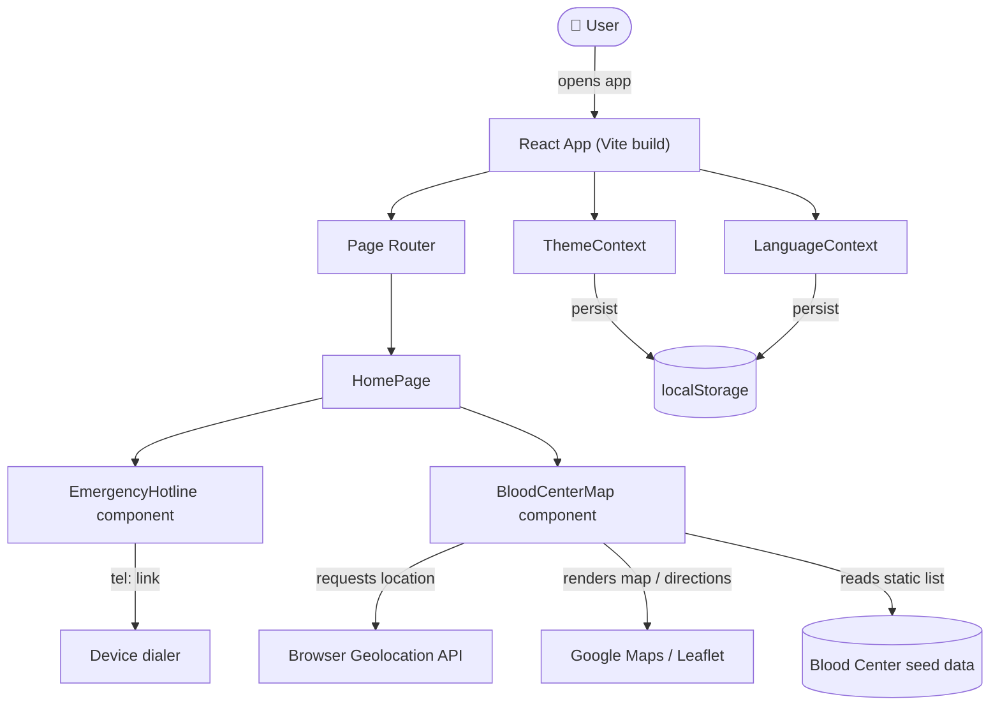
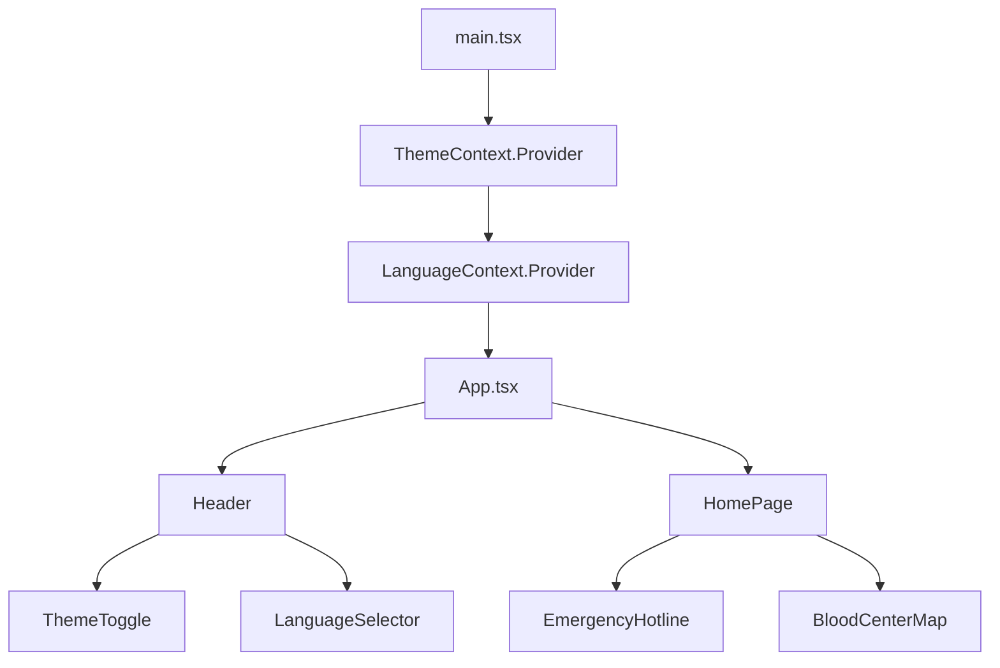
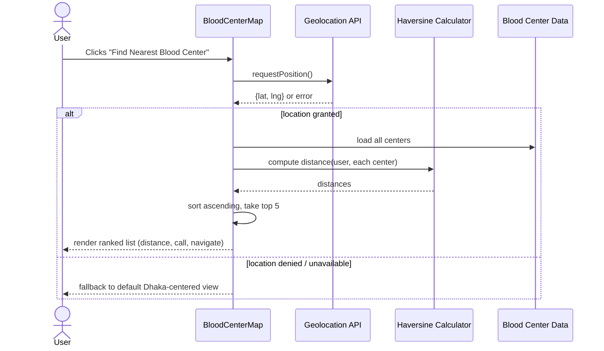
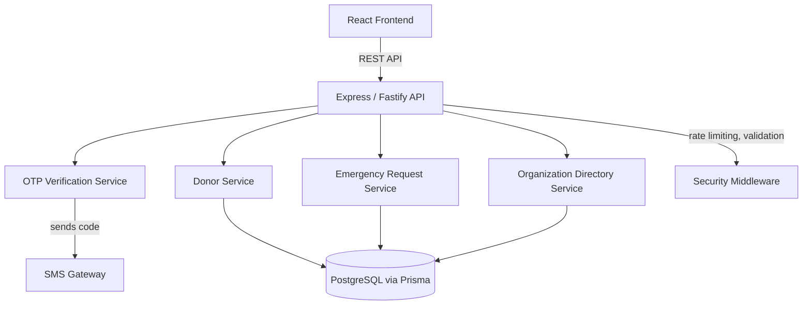

<<<<<<< HEAD
# RoktoSheba

Emergency blood donor network for Bangladesh.

## Structure

- `/backend` — Express API, Prisma/PostgreSQL schema, OTP + JWT security, rate limiting, expiration script.
- `/frontend` — React + Vite + TypeScript app, responsive mobile-first UI, typed API client.

## Setup

### Backend

1. Copy `backend/.env.example` to `backend/.env`.
2. Install dependencies:
   - `cd backend`
   - `npm install`
3. Run Prisma generate:
   - `npm run prisma:generate`
4. Create the database schema and seed organizations:
   - `npm run prisma:migrate`
   - `npm run prisma:seed`
5. Start the API:
   - `npm run dev`

### Frontend

1. Copy `frontend/.env.example` to `frontend/.env`.
2. Install dependencies:
   - `cd frontend`
   - `npm install`
3. Start the dev app:
   - `npm run dev`

## Environment variables

### `backend/.env`

- `DATABASE_URL` — PostgreSQL connection string.
- `JWT_SECRET` — secret for OTP verification and session tokens.
- `OTP_CODE_TTL_SECONDS` — OTP code expiration in seconds.
- `PORT` — backend port.
- `SMS_PROVIDER_API_KEY` — optional, currently mocked by console log.

### `frontend/.env`

- `VITE_API_BASE_URL` — base URL for the backend API, e.g. `http://localhost:4000/api`.

## Development commands

### Backend

- `npm run dev` — start backend in development.
- `npm run build` — compile TypeScript.
- `npm run start` — run compiled production build.
- `npm run prisma:migrate` — apply migrations.
- `npm run prisma:seed` — seed organization data.
- `npm run expire` — expire stale donors after 90 days.
- `npm test` — run backend tests.

### Frontend

- `npm run dev` — start Vite development server.
- `npm run build` — build the static app.
- `npm run preview` — preview the production build.
- `npm test` — run frontend smoke tests.

## Deployment notes

- Build the frontend and serve its static output from a traditional Node static host or CDN.
- Host the backend separately and set `VITE_API_BASE_URL` to the deployed API URL.
- Use PostgreSQL for production and keep `JWT_SECRET` private.
- Run `npm run expire` as a cron job once per day to silence stale donor listings.
=======
<div align="center">

# 🩸 RoktoSheba
### Emergency Blood Donor Network for Bangladesh

Connecting blood donors, patients, and hospitals — fast, when it matters most.


</div>

---

## Table of Contents

- [Overview](#overview)
- [Features](#features)
- [Architecture](#architecture)
  - [System Overview](#system-overview)
  - [Component Architecture](#component-architecture)
  - [Data Flow: Nearest Blood Center](#data-flow-nearest-blood-center)
  - [Planned Backend Architecture](#planned-backend-architecture)
- [Tech Stack](#tech-stack)
- [Project Structure](#project-structure)
- [Getting Started](#getting-started)
- [Environment Variables](#environment-variables)
- [Emergency Hotlines](#emergency-hotlines-reference)
- [Accessibility](#accessibility)
- [Roadmap](#roadmap)
- [Contributing](#contributing)
- [License](#license)

---

## Overview

RoktoSheba (রক্তসেবা — "blood service") is a web platform built to shorten the distance between someone who needs blood and someone who can give it. During a medical emergency, every minute spent searching for a donor or the right blood bank number matters. RoktoSheba puts the essentials — emergency hotlines, the nearest blood centers, and a bilingual interface — in front of the user immediately, with no login and no friction.

The project is being built in phases: the current release is a fast, static-data frontend focused on emergency access; the next phase adds a real backend so individual donors can register, be searched, and be matched against live emergency requests.

## Features

| Feature | Description |
|---|---|
| 🚨 **Emergency Hotline** | One-tap calling to verified blood bank hotlines, surfaced prominently on the homepage with urgency-driven visual design. |
| 🌐 **Bilingual UI (EN / বাংলা)** | Full interface translation with a persisted language preference, so users can operate the app in whichever language they're fastest in. |
| 📍 **Nearest Blood Center Locator** | Uses browser geolocation and the Haversine formula to rank the 5 nearest blood centers by distance, with one-tap call and Google Maps navigation. |
| 🌙 **Dark Mode** | Full dark theme with smooth transitions and system-preference detection on first visit. |
| 📱 **Responsive, mobile-first design** | Built for the reality that most users will open this from a phone, often on a slow connection, during a stressful moment. |
| ♿ **Accessible by default** | WCAG 2.1 AA-oriented: keyboard navigation, ARIA labeling, high-contrast color pairs, large touch targets. |

## Architecture

### System Overview

The current release is a client-side React application. There is no backend yet — blood center data is bundled with the app, and user preferences (theme, language) live in `localStorage`. External services are called directly from the browser.



### Component Architecture



### Data Flow: Nearest Blood Center



### Planned Backend Architecture

The roadmap adds a real backend so donors can register and be searched, rather than relying on a static hotline/center list. This is the target architecture for the next phase:



Key design decisions for this phase will be documented inline in the codebase as they're implemented — see the [Roadmap](#roadmap) for sequencing.

## Tech Stack

| Layer | Technology |
|---|---|
| Frontend framework | React + TypeScript |
| Build tool | Vite |
| Maps & geolocation | `@react-google-maps/api`, `leaflet`, `react-leaflet`, browser Geolocation API |
| State & preferences | React Context API (`ThemeContext`, `LanguageContext`) + `localStorage` |
| Styling | CSS with custom properties for light/dark theming |
| Planned backend | Node.js (Express/Fastify) + TypeScript |
| Planned database | PostgreSQL via Prisma ORM |
| Planned auth | Phone-based OTP verification |

## Project Structure

```
frontend/
├── src/
│   ├── components/
│   │   ├── EmergencyHotline.tsx / .css
│   │   ├── BloodCenterMap.tsx / .css
│   │   ├── LanguageSelector.tsx / .css
│   │   └── ThemeToggle.tsx / .css
│   ├── context/
│   │   ├── LanguageContext.tsx
│   │   └── ThemeContext.tsx
│   ├── pages/
│   │   └── HomePage.tsx
│   ├── App.tsx
│   ├── main.tsx
│   └── styles.css
└── package.json
```

## Getting Started

### Prerequisites
- Node.js 18+
- npm

### Installation

```bash
cd frontend
npm install --legacy-peer-deps
```

### Run locally

```bash
npm run dev
```

Open [http://localhost:5173](http://localhost:5173) in your browser.

### Build for production

```bash
npm run build
```

Production output is written to `frontend/dist/`, ready to deploy to any static host (Vercel, Netlify, GitHub Pages, S3, etc.).

## Environment Variables

If you're using the Google Maps integration, create a `.env` file in `frontend/` (never commit this file — it should be listed in `.gitignore`):

```
VITE_GOOGLE_MAPS_API_KEY=your_api_key_here
```

## Emergency Hotlines (reference)

| Organization | Number(s) |
|---|---|
| Spondon Blood Bank | 01746044205, 01748122764, 01619753240 |
| BADHON Dhaka Central Zone | 01552146988 |

## Accessibility

Built with WCAG 2.1 AA guidelines in mind: keyboard navigation, ARIA labels on interactive elements, color contrast ≥4.5:1, and touch targets ≥44px.

## Roadmap

- [ ] Backend API for donor registration and search (Node/Express + PostgreSQL)
- [ ] Phone (OTP) verification for donor listings and emergency requests
- [ ] Rate limiting and abuse reporting on public-write endpoints
- [ ] Live blood inventory integration
- [ ] Appointment booking
- [ ] SMS notifications
- [ ] Donation history tracking
- [ ] Expanded district coverage beyond initial seed data

## Contributing

Issues and pull requests are welcome. For significant changes, please open an issue first to discuss what you'd like to change.

## License

No license has been added yet — by default, a public GitHub repo without a `LICENSE` file is "all rights reserved," meaning others can view the code but not legally reuse it. If you want RoktoSheba to be open source, add a `LICENSE` file (e.g. MIT) via GitHub's "Add file" option or [choosealicense.com](https://choosealicense.com).

---

<div align="center">

Built to help save lives, one connection at a time. 🩸

</div>
>>>>>>> 14912fa166791626dc34c4e005e26b970ea7e848
